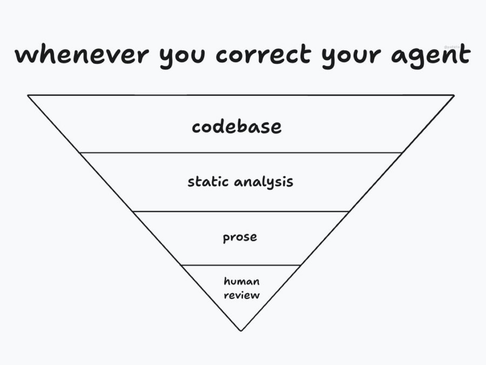

# AGENTS.md — read first (Codex, Cursor, any coding agent)

Ready Set ABC: Pre-K phonics PWA, vanilla HTML/CSS/JS, offline after first load.

## How to work here: the trust pyramid

Requires pstack installed: https://github.com/cursor/plugins/tree/main/pstack (skills like `/poteto-mode`, `/architect`, `/correct`, `/recall`, `/sharpen`, `/in-your-own-words`, `/create-verification-skill`). If they're missing, install pstack before you start.

Whenever something goes wrong, fix it as high up this inverse pyramid as you can. Most effort goes at the top, least at the bottom.

1. **Codebase.** Better architecture, stronger types and invariants, clear boundaries. Agents copy what already exists and take the shortest path, so make the easy thing the right thing. Remove whole classes of problems in code so nobody has to think about them again.
2. **Static analysis.** Lint rules, tests, CI, verification checks. These are cheap ways to catch issues ahead of time.
3. **Prose.** Comments, rules, this file, skills: anything that can't be enforced and needs judgment. Keep it to a minimum, but do write a verification skill (`/create-verification-skill`) for this repo.
4. **Human review.** This scales worst. Spend it on the setup that makes agents do the right thing by default, not on reading every line.

Code fixes are deterministic and token-efficient, and they hold up over time. Prefer them over adding more rules.

## Standing project rules

- For UI/UX work, use whichever of the design-tool repos from https://x.com/roundtablespace/status/2110255627704455591 fit the job (Superdesign Skill, Better Design, Design Taste, Canvas UI, etc.).
- Lucy art: never redraw her from a description. Edit the approved reference images.
- Stay inside the scope of the task you were given. Small draft PRs.
